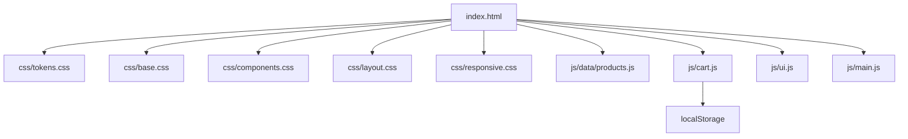

# «Зелёный Дом» — аудит и архитектурный план оптимизации

> Дата: 2026-10-06 · Контекст: лабораторная работа, только чистые HTML/CSS/JS без сборщиков и библиотек.

---

## 1. Текущее состояние

Проект состоит из **одного файла** — [`index.html`](../index.html:1), ~2000 строк:

| Блок | Строки | Доля |
|---|---|---|
| CSS в `<style>` | 10–1341 | ~67% |
| HTML-разметка | 1343–1927 | ~29% |
| JS в `<script>` | 1929–1996 | ~4% |

Секции страницы: шапка (sticky + мобильное меню на чекбоксе), Hero, Преимущества (`#delivery`), Каталог (`#catalog`, 8 карточек), О нас (`#about`), Отзывы, Подписка (CTA), Футер (`#contacts`), тост-уведомление.

Внешних ресурсов нет: визуалы — эмодзи и CSS-градиенты, логотип — инлайн-SVG.

---

## 2. Перечень технических проблем

### A. Архитектура и структура (приоритет: высокий)
| # | Проблема | Где |
|---|---|---|
| A1 | Монолит: HTML+CSS+JS в одном файле. Нет кэширования по ресурсам, нет модульности, правки одной секции затрагивают всё | весь файл |
| A2 | Данные каталога захардкожены: 8 почти идентичных карточек продублированы вручную. Изменение цены/названия = правка разметки | [index.html:1508](../index.html:1508)–[1682](../index.html:1682) |
| A3 | Нет структуры папок (`css/`, `js/`, `data/`, `assets/`) — расширение невозможно | — |

### B. Доступность (приоритет: высокий)
| # | Проблема | Где |
|---|---|---|
| B1 | Класс `.visually-hidden` **используется, но не определён** в CSS — лейбл «Ваш email» виден как лишний текст | [index.html:1816](../index.html:1816) |
| B2 | Мобильное меню на checkbox-хаке: нет `aria-expanded`/`aria-controls`, состояние не озвучивается SR, Escape не закрывает, фокус не управляется. Два элемента с одинаковым `aria-label="Открыть меню"` | [index.html:1348](../index.html:1348), [index.html:1381](../index.html:1381) |
| B3 | «Мёртвые» контролы: кнопка корзины ничего не открывает (нет drawer/modal); соцсети и «Политика конфиденциальности» — `href="#"`; «Все растения» ссылается на собственную секцию | [index.html:1371](../index.html:1371), [index.html:1501](../index.html:1501), [index.html:1892](../index.html:1892), [index.html:1918](../index.html:1918) |
| B4 | Рейтинг звёзд: `aria-label` на `<div>` без `role="img"` может игнорироваться скринридером | [index.html:1759](../index.html:1759) |
| B5 | Нет skip-link для клавиатурной навигации | — |
| B6 | Товары-эмодзи непредсказуемы между ОС (Windows vs macOS) — слабо для e-commerce | [index.html:731](../index.html:731) |

### C. Качество CSS (приоритет: средний)
| # | Проблема | Где |
|---|---|---|
| C1 | Инлайн-стиль `style="color: #d8ead4;"` ломает систему токенов | [index.html:1807](../index.html:1807) |
| C2 | Хардкод цветов вне `:root`: `#24492d`, `#b86d4d`, `#fbf9f5`, `#23472d`, `#386a41` и др. | напр. [index.html:181](../index.html:181), [index.html:637](../index.html:637), [index.html:1047](../index.html:1047) |
| C3 | Нестандартные `font-weight: 650/750/850` — браузеры подставляют ближайший стандартный вес, рендеринг различается между ОС | [index.html:161](../index.html:161), [index.html:233](../index.html:233), [index.html:272](../index.html:272) |
| C4 | Дублирование: SVG-логотип вставлен дважды, `.btn-cart` копирует `.btn-primary` | [index.html:1353](../index.html:1353), [index.html:1856](../index.html:1856), [index.html:196](../index.html:196) |
| C5 | Нет методологии именования классов (BEM/подобной) — риск каскадных конфликтов при росте | весь CSS |
| C6 | Стили 8 секций в одном блоке без разбиения на файлы | [index.html:10](../index.html:10)–[1341](../index.html:1341) |

### D. Качество JS (приоритет: средний)
| # | Проблема | Где |
|---|---|---|
| D1 | Состояние корзины в памяти — теряется при перезагрузке; нет `localStorage` | [index.html:1940](../index.html:1940) |
| D2 | Корзина функционально неполная: нет просмотра, удаления, количества, суммы, оформления | [index.html:1371](../index.html:1371) |
| D3 | Гонка таймеров при быстром двойном клике; `textContent` затирает потенциальные вложенные элементы | [index.html:1956](../index.html:1956)–[1973](../index.html:1973) |
| D4 | Форма подписки — имитация: нет валидации кроме браузерной, `formNote` не восстанавливается | [index.html:1982](../index.html:1982) |
| D5 | Нет guard'ов на `null` — при отсутствии элемента в DOM скрипт падает | [index.html:1930](../index.html:1930) |

### E. Производительность (приоритет: средний)
| # | Проблема | Где |
|---|---|---|
| E1 | Render-blocking CSS: 1300+ строк в `<head>` задерживают first paint | [index.html:10](../index.html:10) |
| E2 | Нет favicon — лишний запрос `/favicon.ico` | — |
| E3 | `backdrop-filter: blur()` на sticky-шапке и бейдже — дорого при скролле на мобильных, нет `@supports`-защиты | [index.html:212](../index.html:212), [index.html:583](../index.html:583) |
| E4 | Нет `content-visibility: auto` для секций ниже первого экрана | — |

### F. SEO и метаданные (приоритет: низкий)
| # | Проблема |
|---|---|
| F1 | Нет Open Graph / Twitter Card — некрасивые превью при шаринге |
| F2 | Нет структурированных данных schema.org (Product, Organization, Review) |
| F3 | Нет canonical, robots.txt, sitemap.xml (для одностраничника — опционально) |

### G. Семантика (приоритет: низкий)
| # | Проблема | Где |
|---|---|---|
| G1 | Секция `#delivery` содержит «преимущества» — якорь не соответствует содержимому | [index.html:1442](../index.html:1442) |
| G2 | `<div class="eyebrow">` — декоративные подзаголовки без семантики | [index.html:96](../index.html:96) |

### Сильные стороны (сохранить при рефакторинге)
- CSS-переменные в `:root` — готовая база токенов.
- Поддержка `prefers-reduced-motion`, `:focus-visible`.
- Адаптивность через `min-width` media queries и `clamp()`.
- `aria-live` на тосте и форме.

---

## 3. Целевая архитектура (без сборщиков)



```
site/
├── index.html            — разметка + подключение ресурсов
├── css/
│   ├── tokens.css        — :root, цвета, шрифты, тени, радиусы
│   ├── base.css          — reset, типографика, утилиты (.visually-hidden)
│   ├── components.css    — кнопки, карточки, формы, тост, бейджи
│   ├── layout.css        — header, hero, секции, footer
│   └── responsive.css    — media queries
├── js/
│   ├── data/products.js  — массив товаров (единый источник данных)
│   ├── cart.js           — состояние корзины + localStorage API
│   ├── ui.js             — рендер карточек, тост, меню, корзина-DOM
│   └── main.js           — инициализация, обработчики форм
└── assets/
    └── favicon.svg
```

**Принципы:**
1. Единый источник данных для каталога — `js/data/products.js`; карточки рендерятся JS-шаблоном.
2. CSS-модули подключаются через `<link rel="stylesheet">` (допустимо для лабораторной без сборщика).
3. JS-модули — обычные файлы, загружаемые с `defer` в правильном порядке.
4. Вся корзина — через `localStorage` с API `cart.js`.

---

## 4. Поэтапный план работ

1. **Каркас**: создать `css/`, `js/`, `assets/`; вынести текущий CSS и JS в файлы без изменений содержимого (страница должна работать как раньше).
2. **CSS-рефакторинг**: разбить по модулям; перенести хардкод-цвета в токены; заменить `font-weight` 650/750/850 на стандартные (600/700/800); добавить `.visually-hidden`, `@supports` для `backdrop-filter`, `content-visibility`.
3. **Данные каталога**: вынести 8 товаров в `products.js`; заменить статичные карточки рендером из массива.
4. **JS-рефакторинг**: `cart.js` с `localStorage`; guard'ы на null; исправить гонку таймеров; переписать форму подписки с восстановлением подписи и валидацией.
5. **Доступность**: skip-link; меню с `aria-expanded`/`aria-controls` + закрытие по Escape; `role="img"` на звёздах; осмысленные fallback для «мёртвых» ссылок (реальные URL или удаление); кнопка корзины → мини-drawer с содержимым корзины.
6. **HTML-чистка**: удалить инлайн-стиль; привести якорь секции `#delivery` к содержимому; убрать дублирование SVG-логотипа (рендер через JS или один элемент).
7. **SEO/мета**: OG-теги, schema.org Product для товаров, favicon.
8. **Проверка**: открыть в браузере (мобильный/десктоп), клавиатура + скринридер (основные сценарии), Lighthouse, `prefers-reduced-motion`.

---

## 5. Критерии приёмки

- Страница визуально идентична текущей (или улучшена) на десктопе и мобильном.
- Каталог рендерится из данных: добавление товара = одна строка в `products.js`.
- Корзина переживает перезагрузку страницы (`localStorage`).
- Меню и корзина управляемы с клавиатуры, состояния озвучиваются.
- `Lighthouse` (Performance/Accessibility/SEO) не ниже текущих значений.
- Код разбит по папкам `css/`, `js/`, `assets/` без внешних зависимостей.